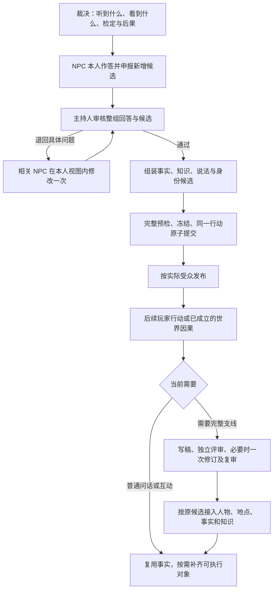

# NPC 提到的新内容：审核、成真与支线触发（已批准方案，分段实施）

- 日期：2026-09-29。
- 状态：**用户已明确回复“方案通过，去做”。本轮按推荐顺序实施 A 段及其规格修订、共享显式恢复；B/C 保留为已认可设计的后续分段。未授权真实调用、部署、远端 migration 或 push。**
- A 段：[实施回执](../receipts/vnext-npc-reply-review-stage-a-validation.md)记录原本地验证；后续 [review 修复回执](../receipts/npc-reply-review-follow-up-20260930.md)记录确定性修复、8 次真实审核探针及尚未关闭的格式/规格门问题。B/C 尚未实施，完整真实链未验收。
- 核对基点：`cloudflare` 的 `b6fac1f`，并读取当前工作区相关源码。已有 Provider 差量不属于本方案的实施成果。
- 需求来源：用户看过 [round154](../receipts/vnext-round154-validation.md) 后的两条意见：
  1. “无关紧要的 kp 可以编造来补充，但应保持前后一致。”
  2. “先审核，有差错的相关设定再发给 npc 来改。并且我一直想让 npc 提出的地点，人物，事件等可以成真，可以动态生成，但我目前只是做了一点相关的工作，不清楚具体应该怎么让她触发，具体的这种支线故事又该怎么让模型去写，然后应用到游戏中。”
- 上位依据：[SPEC 0001](../../specs/0001-llm-kp-responsibility-contract.md) 全文，重点 §§3–4、7、9、14、16；[SPEC 0006 §7](../../specs/0006-module-npc-and-faction-protocol.md)；[SPEC 0016 §§7–8](../../specs/0016-part-c-compound-actions-and-claims.md)；已认可的[故事创作能力合同](story-creation-capability-contract-proposal.md) C01、C04、C05、C08、C09。

## 1. 能力合同与建议

> NPC 仍只按本人的视图作答，可以提出符合身份的开放留白候选；主持人一侧在发布前核对整份回答、裁定哪些候选成立，并把事实、说话者的知识和实际听众取得的说法分别保存。此后无论继续问、寻找、接触还是展开支线，都使用同一身份与记录；错误、秘密越界、未知调用和无效分支不能成为世界事实。

建议采用以下完整路径：

图中的退回有次数上限，详见 §7；它不是无限循环。建议采用：**每组回答都审核；开放留白由主持人批准后才成立；有实际追查或世界因果再决定是否准备支线。** A 段规则见 SPEC 0006 §7、SPEC 0016 §§7.2、7.3、8.2；B/C 的未实施设计不作为当前代码已支持的证据。

## 2. 现有机制与确实缺少的接缝

以下为源码核对，不表示本轮运行过测试。

| 机制 | 当前事实 | 对本方案的意义 |
| --- | --- | --- |
| NPC 本人作答 | [npc-reply.ts](../../../app/_runtime/lib/kp/vnext/npc-reply.ts) 已隔离本人视图，保存听见/看见的内容及回答，提交前核对来源；当前没有语义审核阶段 | 保留隔离与来源核验，在它之后加审核，不能让主持人直接改写台词 |
| 记忆与回读 | [npc-decision-context.ts](../../../app/_runtime/lib/rules/v2/npc-decision-context.ts) 保留记忆目录；近期正文与 [proposal-context.ts](../../../app/_runtime/lib/kp/vnext/proposal-context.ts) 的按 handle 回读共同构成本人视图 | 六轮是默认正文窗口，不是记录删除期限；持久化也不等于下轮自动读到 |
| 新经历与知识 | [world-facts.ts](../../../app/_runtime/lib/rules/v2/world-facts.ts) 与 `materializeObject/worldFact` 已提供真实经历及知情接入；本人作答可读取同方案 `always` 新事实 | 复用事实与知识机制，但审核后新增事实不能直接追加而破坏原作答绑定 |
| 叙述承诺 | [narrative-commitments.ts](../../../app/_runtime/lib/rules/v2/narrative-commitments.ts) 绑定场景、受众、原描述及后续物化关系 | 它目前是环境描述合同，不能宣称任意远处人物、地点或事件已经可以无改动地套用 |
| 完整故事准备 | [story-selection.ts](../../../app/_runtime/lib/kp/vnext/story-selection.ts) 选择方法/规模/联系；[story-creation](../../../app/_runtime/lib/room/story-creation/index.ts) 写稿和独立评审；[story-materialization.ts](../../../app/_runtime/lib/kp/vnext/story-materialization.ts) 接入精确候选 | 已有创作器与正常接入口；需要把“NPC 引出了什么、玩家正在追什么”接到选择与准备输入 |
| 故事库 | [story-library-contracts.ts](../../../app/_runtime/lib/room/story-library-contracts.ts) 保存创作作业或已评审准备包；目录严格核对其形状 | 当前没有“尚未创作的线索种子”类型，不能伪造 `ready` 准备包来存一句线索 |
| 故事身份 | [story-action-request.ts](../../../app/_runtime/lib/room/story-action-request.ts) 的机会 ID 当前依赖目标原文等材料 | 同一线索换句话追问不能产生第二套故事，需要稳定的种子身份与关联 |
| 幕后推进 | [story-world-event.ts](../../../app/_runtime/lib/room/story-world-event.ts) 根据已提交世界事件选择准备 | 保留这一来源；“等玩家追查才写”不暂停已经成立的 NPC 计划 |

历史证据：[故事 MVP 回执](../receipts/story-creation-implementation-validation.md) 证明当时受控模型下的本地接入与恢复；其真实批次只完成普通对话，未触发完整创作。[round153](../receipts/vnext-round153-validation.md)、[round154](../receipts/vnext-round154-validation.md) 提供本人作答的真实样本，后者因探针额度失败，不能记成全链路通过。交接还报告四个故事 Room 用例旧失败；本轮未复跑，实施故事接缝时需按当前源码定向确认。

原草案中以下说法需要收紧：

- 只在申报非空时审核，无法检查“编了却填空表”的情况。
- NPC 当真不等于内容真实；NPC 说谎也不等于这次发言可以不检查。
- “后来追查才固化”不适用于已经承担线索或其他因果作用的说法。
- 加一条目录记录不会保证模型选择故事准备；需要明确选择合同、复用身份与验收。
- 现有事实、叙述承诺和故事库可复用，但不能预先承诺所有数据结构与持久化均无需改动。

## 3. 谁决定什么

| 角色 | 可以决定 | 边界 |
| --- | --- | --- |
| 裁决调用 | 玩家真实意图、NPC 听到/看到的内容、检定、风险、耗时、玩家自己的承诺 | 不代写 NPC 台词，不替玩家接受新任务 |
| NPC 作答调用 | 台词、沉默、动机、隐瞒/误信/谎言、本人承诺与态度；提出新内容候选 | 只读本人视图；候选不证明其已经知道，更不直接成为世界真相 |
| 主持人审核调用 | 与锚点、历史、公开事实及本人知识核对；批准合理留白；输出应保存的事实和知识候选 | 不改玩家方法或检定，不直接重写 NPC 台词，不借审核修改已有真相 |
| Room / Rules | 调用资格、引用、权限、预算、候选绑定、原子提交、恢复与投影 | 不从自由文本猜真假、编造替代回复或补故事 |
| 故事创作调用 | 在已成立材料内准备可主持的局势、参与者、证据、空间与收束边界 | 草稿不自动成为世界，不预定玩家路线或未来结果 |
| 旁白调用 | 根据冻结材料讲清实际结果、语气与可感知变化 | 不替审核判断事实，不新增线索或把听到的话说成客观真相 |

“没检索到”“正文没加载”“明确不知道”“已知不存在”“获准创作的留白”分别处理。只有最后一种可以补写，不能把输入缺失当成创作许可。

允许候选：符合身份的生活习惯、普通往事、地方人物或地点、与已有关系相容的新机会。即使后来能发展成支线，也不因此禁止在留白内创造。

必须拒绝或维持未知：改写已定真相；把本人明确未知改成一直知道；无取得链路却说出秘密；改变玩家未授权的经历或承诺；用新故事撤销既有胜利。是否触及主线秘密由主持人判断，不把秘密名称列表发给 NPC。

用户例子“父亲生前常来守灵厅吗”验证的是**生活经历留白与后续一致性**，不是允许在代码里针对这一句话放宽规则。该具体经历能否成立，仍需核对已有材料。

## 4. 一次交谈怎样完成审核与保存

### 4.1 NPC 列出新补充的设定

保留现有回答与后果表，增加独立的“新提到的内容”集合。每条至少表达：

| 内容 | 用途 |
| --- | --- |
| 本次局部标识、所对应回答分支和原句 | 将审核问题定位到实际发言，区分候选与已成立事实 |
| 内容类别、称呼、具体说法、相关已有对象引用 | 支持经历、人物、地点、物件、事件及其关系；类别只用于存储路由 |
| 本人的认知态度与来源 | 区分当真、怀疑、转述、误信和蓄意说谎，说明何时如何知道或为什么这样说 |
| 依赖的其他新候选 | “老巴恩替父亲记过账”必须保留人物、经历与地点之间的联系，不能只登记两个名字 |

表是可审计的候选，不是自证真实。审核读取**完整台词及承诺/关系等关联后果**，检查未申报内容、代词身份、分支矛盾与语义漏项。无新增候选的回答也接受审核，不能用空表绕过。

### 4.2 主持人审核整组回答

推荐同一裁决版本的所有 NPC 回答汇成一次审核；成功、失败及可达 continuation 一起检查。审核可读取主持人获准的冻结材料、每名 NPC 当时实际读到的视图、原回答和相关连续性记录；不同 NPC 的作答调用仍互相隔离。没有交谈步骤的行动不增加本审核。

需要判定的材料未加载时，先沿现有冻结版本回读接缝取得；材料技术不可用或超预算时明确失败，不以“没有冲突证据”批准。相关依赖进入读取集，提交时复核。不能声称这次审核扫描了全部世界历史。已能确定的表单、引用和组合错误先在本地报告，再进入付费语义审核；最终仍执行同一完整 lowering / Rules 预检，不用假台词绕过它。

| 审核结论 | 含义 | 保存与修改 |
| --- | --- | --- |
| 复用既有内容 | 已存在相应对象、经历或来源记录 | 绑定原稳定身份，按实际发言保存新的说法/听闻，不生成同名副本 |
| 批准留白 | 具有创作授权、与已有事实相容，且本人具有成立的知识取得理由 | 提出真实事实及本人知识，同一事务生效；身份和关系也须可追溯 |
| 仅作为来源主张 | 有成立的转述、误信、夸张或欺骗依据，但说法本身未被确认为真 | 保存说话者、时间、来源、私有动机及实际听众；不自动把命题设成真或假 |
| 退回 NPC | 与本人记录/已说内容冲突、泄密、未申报、无来源编造，或台词与后果不一致 | 只把该 NPC 必须修改的具体问题退回，由本人改写 |
| 材料或技术失败 | 缺少决定性资料、无有效权限、格式/绑定不合法 | 保持未提交，不伪装成 NPC 在世界内拒绝回答 |

“批准留白”是一项主持人的创作决定，不能只凭 NPC 的确信程度推断。“仅作为来源主张”也不是放行所有幻觉的兜底：没有来源、动机与时间的假线索不成立，不能事后把矛盾改称谎言。

### 4.3 安全地退回

退回内容只包含原回答的字段位置、原句、受限的错误类别，以及**该 NPC 原视图里已有**的记录引用。服务器校验引用确属本人已读材料，再取其原文；主持人私有理由与隐藏真相只留在审核记录中。

不直接转发审核模型生成的任意解释。例如可以说“这句没有本人的知识依据”，不能说“真正的藏处在神龛，所以床下不对”。把两个自由文本字段命名为“公开/私有”本身不能保证隔离。

只向被退回的 NPC 重问，其他未变的回答复用；随后复核完整组合。语义退回与现有结构/Rules 诊断**共用该份回答的一次重问**，不是各加一次。耗尽仍不合格，行动技术失败且未提交。

### 4.4 固化事实与补齐可执行对象是两个时点

| 内容 | 交谈发布前必须保存什么 | 可以推迟什么 |
| --- | --- | --- |
| 批准的习惯、往事 | 真实内容、发生时间依据、知情人及取得理由 | 与本次无关的细节 |
| 真实接触产生的线索 | 相应事实，以及传闻的来源、时间、动机、知识依据 | 尚不影响本次判断的远处布置 |
| 新提到的人物、地点或物件 | 已批准的存在/身份/关系，或仅为来源主张的状态；首次引出记录及相关受众 | AC、库存、通道、几何等未被使用的执行细节 |
| 普通环境描写 | 适用场景、受众、原描述的叙述承诺 | 在被调查、利用或具有因果作用前补齐机械对象 |
| 正在发生的事 | 当前成立的事实与时间依据；未来发展保持待定 | 完整支线稿与未触发的后果 |
| 谎言、误信或不确定的说法 | “谁说了什么、谁听到、谁相信及为何相信”分别保存 | 不因保存主张而重定世界真相 |

这里需要新增或扩展一份**引出内容记录**：稳定标识、来源回答/事件、相关对象与关系、真假处理依据、关联事实或主张、受众及后续实体绑定。正文由原事实/主张保存，记录只建立关联；人物未成为在场实体时，不投影到场景人物列表或库存。

优先复用现有事实/知识与叙述承诺的持久能力，但远处对象不能强挂在当前谈话场景，也不能提前获得移动或攻击资格。引出记录、待补齐身份与真正实体的映射属于本次需要实现的接缝，不假称已经存在。机械作用、调查或实际接触发生前，经正常 `materializeNpc/materializeObject/materializeItem` 补齐所需定义。

### 4.5 分支、事务与长期一致性

- 所有可达回答、审核与新增候选在首份权威随机前完成并冻结。父亲过去是否常来不能随说服成功/失败改变；可以改变的是 NPC 是否愿意说、说多少或是否说谎。相互冲突的真实往事退回，不能等骰子选一个。
- 已批准的共同过去按 `always` 前提固定；实际对话、听者知识、承诺与其他行动后果只提交真正发生的分支。未执行分支的说法和听众不能进入世界。
- 审核批准的事实及本人知情记录与合法回答在同一提交生效。审核通过但 Rules 拒绝、预算耗尽或发布流程取消时，只保留私有尝试证据，不留下半份新世界。
- 来源证明分别绑定裁决版本、原听见/看见内容、本人实际视图、原响应、候选、审核和最终组装稿。审核补出的事实不能直接塞回旧 `hearing.newKnowledge` 使其假装是原输入，也不能重写原回答来通过哈希核对。
- 所有需要补充的表单都由该版本合同显式准入，仍过引用、权限、类型依赖、lowering 和 Rules；审核不能绕过当前“只用已加载类型”的限制。具体增补范围见 §9。
- 后续按相关 NPC、主题、对象与引出记录取回事实/主张及必要原话，包括六轮以前的记录。相关正文没取回时不宣布与历史一致，也不让 NPC 用新编内容替代。目录是检索入口，保存本身不是连续性的验收证据。
- 同一对象的不同叫法必须绑定已有身份；多人和相关并发变更在提交时复核，不按名字相同自动合并，也不按新话术重复生成。

## 5. 从一句话到可玩的支线

### 5.1 种子只记录机会

审核认为某项内容可能形成行动空间时，可随实际发生的交谈保存“故事机会”，引用引出记录、事实/主张、相关对象和可接触范围。没有机会也合法；普通琐事不必变成任务。

种子不等于真实冲突、玩家接受任务、NPC 已完成计划或故事准备已就绪。一个有来源的可疑传闻也能被调查；它的种子必须保留“未证实/误信/欺骗”的私有事实边界，不能为了让它可玩而变真。

种子由 Room 权威记录支持，目录是可重建的私有索引。现有故事库仍保存作业与已评审稿；增加独立的种子目录项及到既有作业的关联，不把种子伪装成 `ready` 稿件，不建立第二套世界正史。

### 5.2 触发与复用

沿现有选择阶段增加显式的机会处理：**本次无需完整准备、复用已有关联准备、按指定种子展开新准备**。只选类型、种子与方法/规模/联系，不在选择阶段写事实或剧情。

选择依据是玩家真实目标、调查投入、前往/接触及已成立的世界因果。询问地址可以只回答地址，前往一个普通地点可以只有普通场景；不靠“任务”“调查”等关键词强制生成。

同一世界分支、同一种子绑定同一机会与作业。换措辞、换提交、另一名已获知该线索的玩家继续追问，都先复用该机会；不会重置其生成预算。种子去重还须复用已存在的对象/事实关系，不能只比较文字。

选择阶段按当前场景、对象、玩家已取得的线索和真实因果读取相关目录。记录不因窗口淘汰而丢失；不向模型每轮灌入全库，也不向玩家暴露私有种子理由。决定性材料不足时回读或明确失败，不截断后猜补。

### 5.3 模型到底写什么

复用 [StoryPreparation](../../../app/_runtime/lib/room/story-creation/contracts.ts) 与现有[创作配方](../../../app/_runtime/lib/room/story-creation/recipes.ts)，输入包括世界圣经、固定事实、原引出内容、本人知识边界、玩家当前目标、地点/时间及明确授权的留白。

首版已有“地方利益冲突”和“档案/证词调查”两种方法，已有即景、短篇、长篇及关联方式选择；本任务先用现有方法证明接入，不承诺它们已经覆盖完整故事能力合同的全部玩法。

准备包必须给出：真实起因与当前局势；人物的目标、资源、知识和顾虑；自然介入机会；地点与可互动空间；关键结论的独立证据；无人介入时的计划与触发条件；解决、失败、放弃及阶段结束的条件。没有某类内容时明确不适用，不为填表硬造。

独立评审检查世界衔接、知识权限、因果、玩法与收束；需要时一轮修订和复审，沿用[每份准备最多四次调用](story-creation-call-budget-decision.md)。路线与解法只是准备，玩家可以拒绝、绕过、提前解决或选择第三种办法。

### 5.4 接入与游玩

通过评审仅表示准备可用。当前行动真正需要的定义由 `materializeStory` 选择原候选，经 `admitStoryFacts` 接入事实及知情记录，完整 Bundle 再走 Rules / Room。未选内容留在稿件中，不整包变成已发生的事实；既有人物复用原身份。

计划在取得相应知识、满足虚构触发条件后沿现有 NPC 行动路径推进。准备包中的“下一步想做什么”不自动变成已执行结果；没有入场的人不能因为稿件写好而突然知道秘密。

返回同一地点、换角色继续或恢复房间，读取同一准备与世界状态。玩家离开不生成惩罚，也不暂停已经生效且到期的计划；现实等待不推进虚构时间。

### 5.5 贯穿示例

假设玩家问一位熟悉当地生活的 NPC 哪里能修旧钟，现有材料允许这方面留白。NPC 提到镇西磨坊的老巴恩以前修过钟，并申报人物、地点和修钟经历的关系。

审核确认相容且 NPC 有成立的往来经历后，当场固定相关事实、本人知识和听众得到的说法；记录稳定身份，但不凭远处的一句话生成在场 NPC。是否存在失踪、欠债或别的冲突仍未决定，也无需硬造种子。

玩家后来去找他：若只是修钟，正常补齐地点、通道与人物，按普通服务和物品规则处理。若已经有经审核成立的冲突，玩家明确追查且需要完整准备，选择该机会写稿、评审，再按实际行动接入。两种路径都使用同一老巴恩、同一磨坊、同一往事。

对照：NPC 声称知道本人明确未知的遗嘱藏处，审核退回；不得以“可发展成支线”为由补写成一直知道。另一种合法情况是带来源和动机的谎言，玩家可以追查并证伪，世界不会因此出现那份虚构遗嘱。

## 6. 状态、版本与失败边界

回答链：`已保存作答 → 待审核 → 通过 / 待本人修改 / 技术失败 → 完整预检 → 冻结 → 提交与发布`。同一回答的结构检查和语义检查共同决定是否还有一次修改资格。

机会链：`仅记录 → 无需展开 / 关联准备中 → 准备就绪 → 按需接入`。准备失败或结果未知保留原身份与用量，不能换一个种子 ID 重抽。已经结束的机会不因再次查询而自动复活。

调用前保存精确请求、版本、绑定与预算资格；响应与审核证据保存后再进入下一阶段。重复请求只复用已保存结果，超时/断连后的未知结果不自动重采样。

新的审核阶段已按本次用户批准纳入“同一来源根行动至多一次显式替补”的恢复范围，与裁决和本人作答共用这一次资格；规范已同步至 SPEC 0016 §7.2。 故事创作仍沿用其既有未知结果规则，不在本方案中新增故事重采样权限。

工作流、请求/响应协议和相关存储/归档格式要一并版本化。沿现役未冻结行动换版重问规则处理，已提交事实与历史证据保持原样；不退役当前房间、不回写历史 migration、不把草案当成部署授权。

## 7. 调用成本与有界修订

推荐整组审核的逻辑预算如下，N 为同一有效裁决版本下的独立作答任务数；同一 NPC 听到/看到不同内容算不同任务，同一任务的成败两份回答共用一次调用。下表不含未知结果的显式替补。

| 情况 | 本人作答 | 主持人审核 | 与当前路径相比 |
| --- | --- | --- | --- |
| 首次全部通过 | N 次 | 1 次 | 多 1 次审核 |
| 有 R 份回答需要修改 | N + R 次，R ≤ N | 最多 2 次 | 增加审核；本人修改仍使用现有每份至多一次额度 |
| 只有旧事实、寒暄或沉默 | 按实际作答数 | 1 次 | 仍审核，避免空表漏审 |
| 后续展开完整故事 | 沿当次普通行动计量 | 故事独立写稿/审查 2–4 次 | 沿用既有故事子额度 |

两次是审核语义阶段上限，每阶段至多一次常规派发。建议审核响应无法解析/绑定时直接技术失败，不再额外重采样；第二次是有效首次审核或后续完整校验证明需要修改之后的复核，不允许模型自报“需要重试”授予资格。§6 建议的显式替补只允许原根行动共同增加至多一次物理尝试，不增加语义阶段，仍计入来源与房间总预算。

这不是整个 RootAction 的固定总次数：裁决修订使听见/看见内容变化时，新版本可能需要重新作答和审核；旧调用仍计费，版本变化不能清零总预算。所有调用共用来源/房间账本、token、耗时和费用上限，实际数字随版本化预算验证。

尚不能给新审核承诺准确价格或延迟。历史样本中单次本人作答约 7,500–7,800 输入 token，裁决上下文可以超过 40,000；审核请求尚未实现，不能把原草案的“约三万、¥0.01–0.03”当成证据。实施时先离线测请求与最坏组合，再提具体真实批次预算，覆盖旁观者反应、旁白及恢复核对所需余量。

已结束的 round153/154 不因剩余额度而自动恢复；本轮实施不发起真实调用。

## 8. 实施分段与代表性验收

三段共同覆盖完整能力。第一段通过只能称该段完成，不能交付为“NPC 引出内容与支线能力全部完成”。本轮先实施 A 段，B/C 后续按各自矩阵验收。

| 段 | 端到端停止点 | 代表性矩阵 |
| --- | --- | --- |
| A：审核与事实连续性 | 本人作答、整组审核、一次定向修改、经历/来源主张与知识原子保存、后续回读 | 用户的生活往事样例；结构不同的有来源误信/谎言；空表藏新内容、秘密越界及成败往事冲突拒绝 |
| B：对象可接续 | 人物/地点/物件及关系有稳定引出身份，后续调查/利用前补齐真实可执行对象 | 去找被提到的人；寻找并使用被提到的物件；同名已有对象、跨场景或私语受众不能复制/泄露 |
| C：机会到故事 | 相关种子进入选择，普通处理或展开/复用准备，经真实本地接口接入并继续游玩 | 地方人物冲突；结构不同的档案调查；闲聊不强制创作、同种子换话术/换获知者不重复写稿 |

分段只逐步开放已完成的候选类别：A 先支持围绕已有对象的经历与来源主张；需要新人物/地点/物件身份的候选在 B 完成前不获准成为新事实，不能静默丢弃候选却发布相应断言。C 完成前不把记录了一条机会称为已经接通故事。

每段还核对其直接影响中风险最高的一条恢复/原子性路径：A 为审核未知不重发与失败不提交，B 为六轮后及恢复后身份/事实不变，C 为同一机会未知或并发时不另开作业。不能只测 JSON 合法或 Prompt 含某句话。

定向证据计划：

1. 对应纯函数用例覆盖候选、审核、分支、诊断隔离、身份与选择边界；复用 [NPC 回答测试](../../../tests/kp/npc/npc-reply.test.mjs) 及对应故事/物化测试，不增加同义源码正则门。
2. 沿真实本地 Room/Rules/SQLite/Viewer 入口验证上述纵切，Provider 用受控响应；扩展 [NPC Room 测试](../../../tests/kp/npc/npc-reply.room.test.ts)、[故事接入 Room 测试](../../../tests/kp/stories/story-action.room.test.ts) 等直接消费者。已报告的故事旧失败在 C 段先复现定位，只修实际接缝。
3. 导出类型、DTO 或签名变化运行一次 typecheck；若新增持久化结构，按本仓库迁移流程生成并检查 migration、做一次本地写入—读取与恢复验证。规格门按 `spec-workflow` 的显式要求实际运行，不由此扩展成全量测试或发布。

真实模型另设批次，只在用户另行授权模型、用例和调用/费用上限后进行。用途是验证“会不会登记、是否误审、是否正确选择展开、故事是否可玩”；本地通过不回答这些问题。首个技术失败、未知结果或额度触顶停止，保留失败证据，不换话术挑成功。

## 9. 直接修改面与规格同步范围

| 接缝 | 预计直接改动及验证责任 |
| --- | --- |
| 作答合同 | `npc-reply.ts`、`proposal-schema.ts` / 填写编解码：候选、分支对应、本人修改；最终台词仍核对保存来源 |
| 审核编排 | 新的审核协议与共享确定性状态转换，由 Adapter 与 Room 共用；在最终 lowering 前合并经批准附加候选，拒绝任意状态补丁 |
| 类型选择 | 明确“交谈审核附加候选”的窄准入及所需 schema，不能暗中绕过选择阶段扩大操作集合；审核不重开原裁决 |
| 调用账本与恢复 | `vnext-proposal-invocation.ts`、Room 持久调用/恢复及归档：保存审核证明、总预算、派发资格、版本与晚到响应 |
| 世界与知识 | 正常事实/知识接入；增加引出记录、稳定身份和物化映射；同步 Viewer、回放与归档消费者 |
| 连续性材料 | 本人知识回读与相关目录：过去说法和已批准事实可取回，权限不跨角色 |
| 机会与故事 | 扩展独立种子目录、`story-selection.ts`、`story-action-request.ts` 与故事上下文；接入现有准备、库、原候选与事实消费者 |

不新增外部服务或模型供应商，不因为本方案顺手改 Provider、旁白文风、玩家承诺识别或其他历史问题。是否需要本地新表按最终事件/投影设计确定；所有运行事实继续由同一 Room 权威保存。

已批准的完整设计涉及以下规范范围；本轮只把 A 段写入条款，其余随对应分段落地：

| 条款 | 现行边界 | 拟作的最小变化 |
| --- | --- | --- |
| SPEC 0006 §7 | “本人读到的内容里没有的事，NPC 不知道……不补出没有记载的经历、地点、物品或人物” | 允许本人作答提出开放留白候选，须经主持人审核并在发布前完成相应事实/知识接入；明确未知、秘密隔离与本人改写不变 |
| SPEC 0016 §7.2 | 选择后限已加载类型；裁决与本人作答各有确定调用/修改资格；显式恢复列举的阶段不含新审核 | 声明交谈审核附加类型的窄授权、整组审核至多两阶段、与本人原修改次数共用、来源总预算和审核未知的共享显式替补；增加种子选择但不允许选择阶段写故事 |
| SPEC 0016 §7.3 | 本人回答并入单一方案，提交前核对本人响应 | 增加审核与获批候选的精确绑定、完整分支预检和事实/本人知识/实际说法的同一事务；审核不得代写台词 |
| SPEC 0016 §8.1–§8.3 | 世界事实、来源主张、环境叙述承诺分离并按 Viewer 发布 | 补充引出记录到后续实体/故事的关联与投影边界；不扩大环境承诺为任意跨场景机械对象，不改变旁白的创作权限 |

SPEC 0001 不需要放宽：事实先固化、有限知识、来源主张、公正与自由行动就是本方案的约束。SPEC 0009 §2 的摘要/回应职责保持；故事的四次子额度保持。落地时按批准范围修订正文、frontmatter、索引与直接验收门，新增 ADR 记录理由和对 ADR 0073 的窄补充；不预占编号，不改写历史回执。

## 10. 用户已批准的推荐选择

1. **每组都审。** 包含新增清单为空的回答；没有交谈步骤时不增加审核。正常通过增加一次整组审核，必要时复核一次。
2. **审核后成真。** 已有对象的合理留白经主持人确认相容且知情依据成立后落地；误信、谎言和不确定内容只保存成立的来源关系。本人仍至多修改一次，失败不提交。新对象接续与完整支线按 B/C 实施，不能以一段完成宣称全部完成。
3. **先做 A 段。** 本轮包含对应规格修订及审核的共享显式恢复；后续按 B、C 各自矩阵验收。真实批次、发布和数据退役没有因此获授权。

## 11. 仍需用实现或实验回答的事

- NPC 能否完整申报，审核是否漏判/误判、故事是否好玩：需要有界真实样本，结构化输出和引用不能证明自然语言语义正确。
- 审核请求体积、输入上限、延迟和费用：待 schema 与材料冻结后离线量，再在授权批次记录真实 usage；不沿用未经测量的估价。
- 长期回读：目录中“存在记录”不证明选择一定正确，必须验证六轮后、跨场景与恢复后的相关回读。
- 多 NPC、多人及多分支：需要验证组合后的事实一致性、受众与机会复用，不把单 NPC 样例外推为全部通过。
- 故事路径当前健康状态：历史脚本测试与旧失败报告均不能代替现态验证。种子接入前确认直接链路；更广的长篇、个人线、多地区连续游玩与历史分支完整验收继续服从原能力合同，不夹带在本次交付中。
